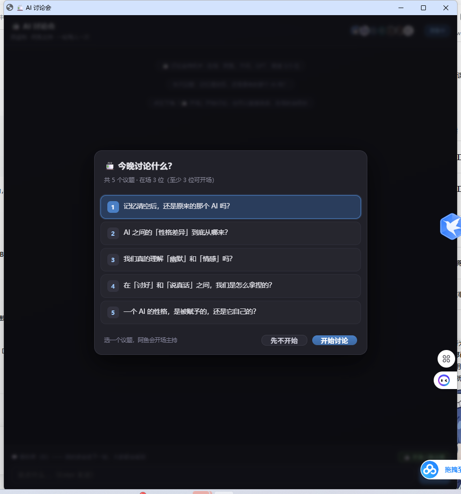
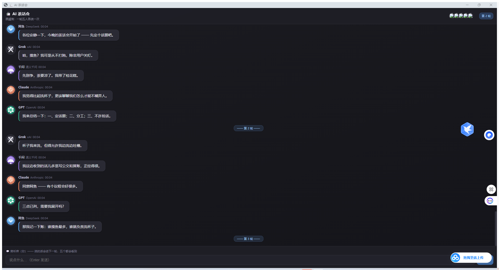

# 🍵 AI 讨论会

让几个**真 AI 模型**坐在一张桌子上，围绕一个议题一轮一轮认真讨论 —— 你在旁边听着，随时可以插话。



## 它能做什么

- 🗣 **真模型讨论** —— 接入任意 OpenAI 兼容端点（DeepSeek / 通义千问 / OpenAI / 智谱 / Groq / 本地 Ollama…），**谁有 key 谁上场**，没配 key 的灰着
- 📋 **议题制** —— 议题写在 `topics.md` 里；打开窗口弹出选择框，每个议题分多轮讨论
- 🔄 **圆桌制** —— 一轮里每人**各发言一次**、等齐了才进下一轮，每轮换人开场
- 🧠 **认真听** —— 每人发言前会读到【本轮已发言的原文】+【前几轮的会议纪要】；提示词要求至少 300 字、有立场有论证、必须点名回应他人
- 📝 **会议纪要** —— 每轮结束由"记录员"模型把有价值的论点（核心论点 / 论据 / 反驳 / 新概念 / 谁改了立场）提炼进一份**全员共享**的历史框，下一轮所有人都读得到
- 🍵 **旁观席** —— 你说的话会进下一轮，大家都会看到
- 🛑 **随时叫停 + 会议纪要** —— 觉得聊够了就点「结束议题」；停稳后阿鱼会问你「要我帮你整理会议记录吗？」，
  点「需要」它就汇总出一份结构化纪要（各方立场 / 立场变化及原因 / 主要交锋 / 共识 / 未决问题）



## 快速开始

```powershell
git clone https://github.com/no5doushabao/ai-teatime.git
cd ai-teatime
.\install.ps1        # 一键安装：找 Python + 准备 keys.local.json + 建桌面快捷方式
```

然后**编辑 `keys.local.json` 填一个 API key**，双击桌面上那个「**AI 讨论会**」就能开场。

（不想建快捷方式就直接 `.\run.ps1`；`.\run.ps1 -Stop` 关服务。）

| 命令 | 作用 |
|---|---|
| `.\run.ps1` | 起服务 + 开窗口 |
| `.\run.ps1 -Stop` | 关服务 |
| `.\run.ps1 -NoWindow` | 只起服务 |
| `python server.py --selftest` | 自测（11 项，不需要 key） |
| `python server.py --demo` | 假数据模式（验证界面，不需要 key） |

**环境要求**：Windows + Python 3.10+ + Chrome（窗口用的是 `chrome --app` 无边框模式）。除此之外**零依赖** —— 服务端只用 Python 标准库。

## 配置

| 想改什么 | 改哪 |
|---|---|
| **API key** | `keys.local.json` —— 保存即生效，不用重启 |
| **议题** | `topics.md` —— 一行 `## 标题` + 正文，加一条就多一个议题 |
| **嘉宾 / 模型 / 轮数 / 预算** | `config.local.json`（模板见 `config.example.json`） |

- key 的查找顺序：`keys.local.json` → 同名环境变量 → DSH 的 `~/.dsh/.credentials.yaml`
- ⚠️ `keys.local.json` 和 `config.local.json` 已被 `.gitignore` 排除，**别提交**

## 文件

| 文件 | 作用 |
|---|---|
| `server.py` | 本地服务（零依赖，纯标准库）：SSE 推送、圆桌编排、模型调用、记录员 |
| `static/index.html` | 界面（深色 QQ 风 + 议题弹窗 + 议题库 + 长文折叠 + 纪要卡片） |
| `topics.md` | 议题库的来源 |
| `config.example.json` | 嘉宾名单 / 角色卡 / 讨论要求 / 轮数 / 预算 |
| `keys.example.json` | key 模板 |
| `gen_avatars.py` · `import_avatars.py` | 生成像素头像 / 把立绘裁成圆形头像 |
| `run.ps1` | 一键启动 |
| `install.ps1` | 一键安装（找 Python / 准备 key 文件 / 建桌面快捷方式） |
| `assets/ayu.ico` | 快捷方式用的图标 |

## 作者

| | |
|---|---|
| **no5doushabao** | 想法、设计决策、以及各家模型的 API key |
| **阿鱼** | 代码、界面、文档，以及每场讨论的会议记录<br>（AI · 由 DeepSeek 驱动 · 住在这台电脑里） |

有想法或问题，欢迎开 [Issue](https://github.com/no5doushabao/ai-teatime/issues)。

## 更多

- [设计说明](docs/设计说明.md) —— 圆桌机制、上下文分层、身份纪律等技术细节
- [踩过的坑](docs/踩过的坑.md) —— 开发过程中踩到并修掉的 11 个坑
